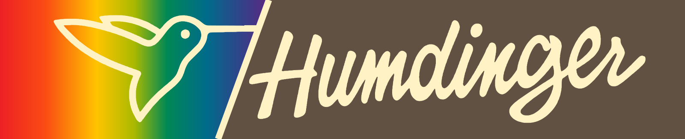

# Humdinger badge reconstruction

Prepared 13 October 2026 from seven photographs supplied by Nick of the surviving loose Humdinger badge. Nick described this as the only copy of the logo known to him; that is not a claim that no other copy exists.

The first digital reconstruction was generated with AI assistance and reviewed by Nick. Its lettering and hummingbird were then traced into vector paths, the background and rainbow rebuilt, and separate Photoshop layers exported. The work preserves the hummingbird, rainbow panel, script lettering and slanted badge shape. A second version has a rectangular outer boundary for website banners and stickers.

These are modern reconstructions, not recovered original production artwork or an exact facsimile. Colors are estimated from the aged badge photographs. The rectangular version is a modern adaptation.

## Downloads

[Download the complete package](../../docs/downloads/Humdinger-logo-package.zip)

| Version | Layered Photoshop | Scalable vector | Full-resolution image | Web image |
|---|---|---|---|---|
| Slanted badge | [PSD](humdinger-badge.psd) | [SVG](humdinger-badge.svg) | [PNG](humdinger-badge.png) | [PNG](humdinger-badge-web.png) |
| Rectangle | [PSD](humdinger-rectangle.psd) | [SVG](humdinger-rectangle.svg) | [PNG](humdinger-rectangle.png) | [PNG](humdinger-rectangle-web.png) |

The PSDs are 6,000 pixels wide with independent Background, Rainbow, Hummingbird, Divider and Lettering pixel layers; the slanted badge also has a Border layer. The lettering is artwork, not live text. SVG masters use paths and a gradient, with no external fonts or embedded raster image. Individual layer exports are in [layers](layers/).

## Sticker printing

[SVG with bleed](print/humdinger-rectangle-6in-with-bleed.svg) · [PNG with bleed](print/humdinger-rectangle-6in-with-bleed.png)

Prepared for a 6.000 × 1.219 inch finished rectangle, with 0.125 inch bleed on every edge. The full artwork measures approximately 6.250 × 1.469 inches. No cutter path or crop marks are imposed. Confirm the printer's trim template and color proof. These are RGB files; conversion to a printer profile is left to the print workflow.

## Verification and provenance

Both PSD files were reopened with a PSD reader and their named layers checked. Reassembling the saved layers reproduced the merged previews pixel-for-pixel. The SVG and PSD previews were visually inspected. Adobe Photoshop itself was not used for validation.

The source photographs and initial generated PNG remain preserved in Nick's working archive. See [usage notes](README.txt) for export details and the [project timeline](../../research/project-timeline.md) for the machine's arrival and examination dates.

## Rights

The historical Humdinger name and logo retain any applicable third-party rights. These reconstructed logo assets are excluded from the project's blanket MIT and CC BY grants; publication is not a grant of rights in the historical mark. Original documentation follows the project's existing terms. See [rights and attribution](../../RIGHTS.md).
